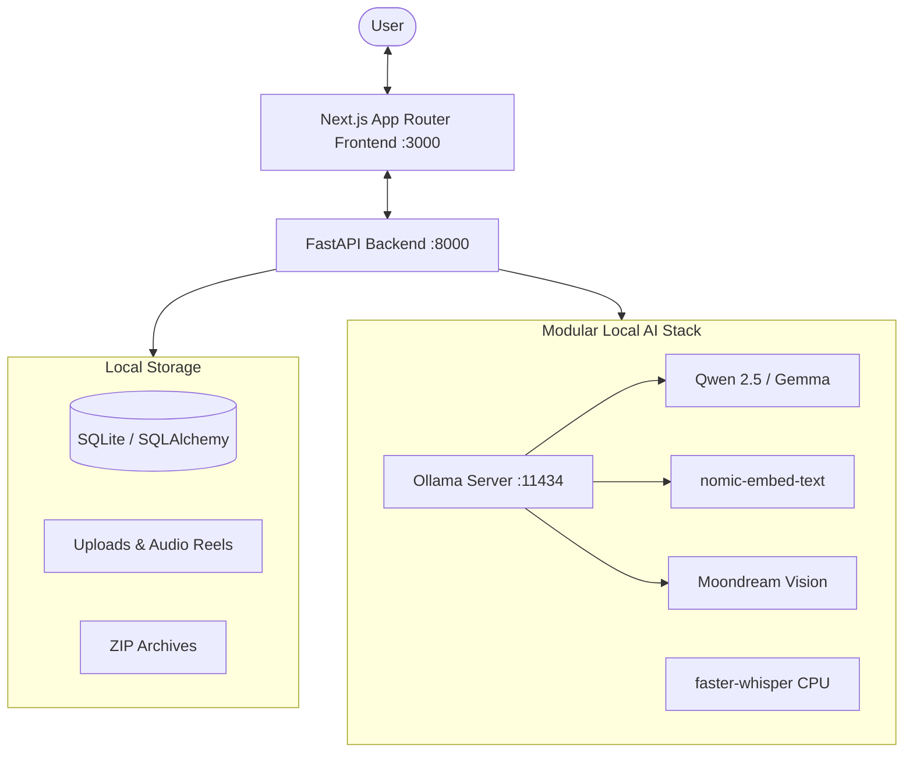

# EchoVault — The Memories That Refuse to Disappear

> *"Some memories never leave. They just wait to be remembered."*

**EchoVault** is a polished, production-quality, local-first digital memory archive built for the **Hacktoberfest Open-Source AI Challenge — Week 4: Ghost in the Machine**.

EchoVault preserves, understands, organizes, and rediscovers personal memories through photographs, analog audio cassettes, scanned documents, and written memoirs. It transforms your memories into an atmospheric abandoned digital archive where forgotten moments are waiting to be remembered.

---

## 1. Core Philosophy

EchoVault is built on the conviction that personal digital memories must belong solely to the individual:

- **100% Privacy-First:** Personal memories never leave your machine. No mandatory external cloud AI APIs, no subscription lock-in, and zero telemetry.
- **Local Inference:** Speech transcription, vision understanding, semantic embeddings, and language generation run on local hardware.
- **Open-Weight Models:** Built with open models (Qwen, Gemma, Nomic Embeddings, Moondream, Faster-Whisper) with a modular model adapter architecture.
- **Offline-First:** The entire application functions without an internet connection once models are pulled locally.
- **User Ownership:** Export your entire vault anytime as a self-contained ZIP archive with JSON metadata and a human-readable Markdown catalog, or permanently wipe it with one click.
- **Ethical Transparency:** AI-generated summaries and ghost narratives are clearly distinguished from original historical evidence. The RAG engine never invents facts; when evidence is absent, it says so plainly.

---

## 2. Technology Stack

### Frontend
- **Framework:** Next.js 15 (App Router, React 19)
- **Language:** TypeScript
- **Styling:** Tailwind CSS v4 with custom atmospheric Gothic/Archival palette
- **Icons:** Lucide Icons
- **Animation:** Framer Motion & CSS grain overlays

### Backend
- **Framework:** Python FastAPI (asynchronous, high performance)
- **Database:** SQLite with SQLAlchemy 2.0 (WAL mode, foreign keys enabled)
- **Validation:** Pydantic v2 (ConfigDict, strict schemas)

### AI Infrastructure
- **LLM Inference:** Ollama (`qwen2.5:1.5b` / `ornith:9b` / `gemma:2b`)
- **Embeddings:** Ollama (`nomic-embed-text`, 768-dim dense semantic vectors)
- **Vision Understanding:** Ollama (`moondream`, lightweight edge vision model)
- **Audio Transcription:** `faster-whisper` (int8 quantized local Whisper model running on CPU)
- **Audio Narration:** `edge-tts` / local synthesizer for atmospheric storytelling
- **Metadata Extraction:** `exifread` & `Pillow` (EXIF camera/exposure/date), `mutagen` (audio duration/bitrate), `pypdf` (document parsing)

---

## 3. Application Architecture



---

## 4. Key Features

### A. The Memory Vault
A central repository supporting:
- Photographs (JPG, PNG, WebP) with zoom frame and EXIF metadata extraction.
- Magnetic audio tapes (MP3, WAV, M4A, OGG) with vintage tape-reel playback.
- Scanned documents and PDF logs with text extraction.
- Written recollections penned directly in the interface.
- Filterable by collection, keyword, person, date, or tag.

### B. The Echo Engine
An asynchronous background ingestion pipeline:
1. Detects file format and validates security bounds.
2. Extracts technical metadata (camera model, date taken, audio bitrate/duration, PDF pages).
3. Transcribes speech via local `faster-whisper`.
4. Analyzes photographs using local vision models (`moondream`).
5. Generates concise, evocative summaries using the local LLM.
6. Extracts entities (people, locations, dates, themes) as structured JSON.
7. Chunks content and generates 768-dimensional dense vector embeddings.
8. Writes step-by-step logs into the archival processing history.

### C. Ask the Archive (Conversational RAG)
A conversational interface over your memories with strict anti-hallucination groundings:
- Embeds user inquiries and retrieves top matching chunks from local vector store.
- Synthesizes answers based **strictly** on retrieved excerpts.
- Displays interactive **Source Citations** linking directly back to original memories.
- Explicitly states when the archive lacks evidence on a subject.

### D. The Ghost Chamber (Halloween Experience)
The signature Halloween experience for **Ghost in the Machine**:
- Select one or more archived memories to summon into the chamber.
- Choose from 4 distinct narrative styles:
  - **Haunted Gothic:** Poetic, shadowy folklore blending real relics into melancholy legend.
  - **Mysterious Noir:** Cold archival investigation piecing together timestamps and anomalies.
  - **First-Person Echo:** Spoken from the viewpoint of a silent physical relic (a tape ribbon or faded photo).
  - **Chronological Reconstruction:** Timeline uncovering the sequence of events and pauses between them.
- Optional voice narration synthesized locally.
- Clear ethical disclaimer: Stories are fictional interpretations, not actual messages from deceased persons.

### E. Memory Timeline & Connection Graph
- Chronological timeline grouping memories into Year and Month clusters.
- Filter by people, topics, and file types.
- Subterranean connection graph revealing hidden threads and shared themes between disparate relics across decades.

### F. The Forgotten Drawer
- Automatically surfaces memories that have rested in silence the longest.
- Uncovers uncaptioned photographs, untranscribed cassette ribbons, and overlooked moments.

### G. Data Ownership & Settings
- Live status monitor for local AI models and host hardware (CPU, RAM).
- Physical storage metrics and database size.
- Export full archive as `.zip` containing:
  - `archive_metadata.json` (complete structured export)
  - `ARCHIVE_CATALOG.md` (clean, human-readable offline Markdown index)
  - Original media files
- Permanent archive wipe or reset to default fictional sample memories.

---

## 5. Getting Started

### Single-Command Launch (Recommended)
You can launch the entire stack (Ollama check, FastAPI backend, and Next.js frontend) with a single command from the project root:

```bash
./start.sh
```
*(Alternatively, `npm start`, `./run.sh`, or `make run` all execute this unified launcher).*

The script will:
1. Verify or start the Ollama local AI server.
2. Initialize and start the FastAPI Python backend on `http://localhost:8000`.
3. Check and launch the Next.js production web UI on `http://localhost:3000`.
4. Provide a clean graceful shutdown for all services when you press `Ctrl+C`.

---

### Manual Setup (Step-by-Step)
```bash
# Start Ollama
ollama serve &

# Pull models for EchoVault
ollama pull qwen2.5:1.5b
ollama pull nomic-embed-text
ollama pull moondream
```

### Step 2: Setup and Run the Backend
```bash
cd backend
python3 -m venv venv
source venv/bin/activate
pip install -r requirements.txt

# Run FastAPI server on port 8000
python -m uvicorn app.main:app --host 0.0.0.0 --port 8000
```
*Note: On first startup, EchoVault automatically seeds a fictional Halloween sample archive (Blackwood Manor 1988–1994, Whispering Pines 1973) so you can immediately explore.*

### Step 3: Setup and Run the Frontend
```bash
cd frontend
npm install
npm run build
npm run start -- -p 3000
```

Open your browser at [http://localhost:3000](http://localhost:3000).

---

## 6. Docker Compose Setup

Run both frontend and backend using Docker Compose:

```bash
docker-compose up --build
```

Ensure Ollama is running on your host machine at `http://localhost:11434`.

---

## 7. Running Backend Unit Tests

```bash
cd backend
PYTHONPATH=. venv/bin/pytest tests/
```

Test suite validates:
- Health check and API status
- Memory listing, filtering, and detail extraction
- Manual story creation and tag association
- Forgotten drawer discovery algorithms
- Vector store cosine similarity and semantic search
- Ghost chamber narrative styles and ethical disclaimer verification

---

## 8. License

Open source under the [MIT License](LICENSE). Built for the Hacktoberfest 2026 Open-Source AI Challenge.
